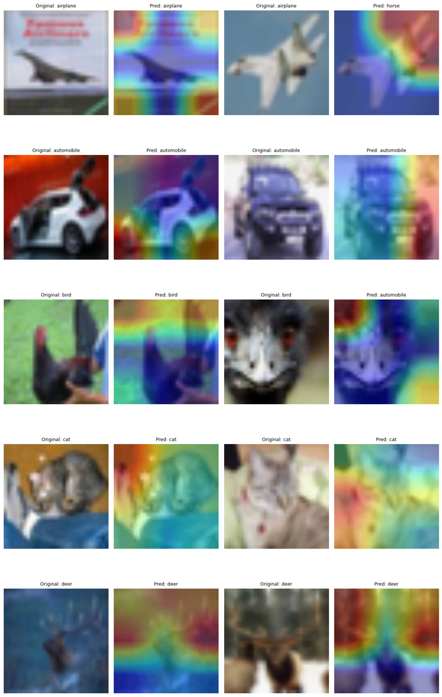

# Clasificación de imágenes CIFAR-10

Comparación de tres enfoques para clasificar las 60.000 imágenes de CIFAR-10 (32×32 píxeles, 10 clases): una CNN entrenada desde cero, transfer learning con MobileNetV2 y fine-tuning del mismo modelo. Al final uso GradCAM para ver en qué partes de la imagen se fija el mejor modelo.

## Modelos

- **CNN desde cero:** tres bloques convolucionales (32, 64 y 128 filtros) con BatchNormalization, MaxPooling y Dropout, y una capa densa de 256 neuronas.
- **Transfer learning:** MobileNetV2 preentrenada en ImageNet con los pesos congelados. Las imágenes se redimensionan a 96×96 dentro del modelo.
- **Fine-tuning:** el modelo anterior con las últimas 30 capas descongeladas y un learning rate mucho menor.

En todos se aplica data augmentation (volteo horizontal, rotación y zoom suaves) para reducir el sobreajuste.

## Resultados

| Modelo | Accuracy test | Peor clase (F1) |
|---|---|---|
| CNN desde cero | 77 % | cat (0,59) |
| Transfer learning | 82 % | cat (0,69) |
| Fine-tuning | 89 % | cat (0,79) |

Cat es la clase más difícil en los tres modelos: se confunde sobre todo con dog y, curiosamente, con frog. Automobile, ship y truck son las mejor clasificadas.

## GradCAM

En las clases con formas claras (coches, barcos, camiones) el modelo se fija en el objeto. En otras, como bird, deer o frog, se apoya bastante en el fondo. En el caso de frog acierta el 94 % de las veces, pero el mapa no se centra en la rana, lo que sugiere que reconoce el fondo verde más que al animal. Eso también explicaría por qué algunos gatos y pájaros se clasifican como ranas.
